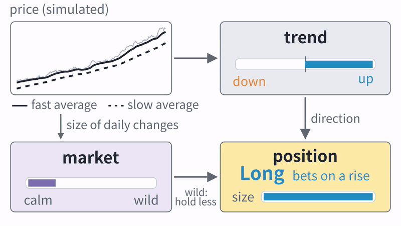

</img>

# Trend Following

Exploring trend following with PyTorch and Rust: a minimal core as simple programming examples (PyTorch 120, Rust 334 lines of code)

The core math of systematic trend following as small pieces, the same in PyTorch and in Rust: exponentially weighted filters, moving average crossovers and their t-statistic, time series momentum, volatility targeted positions, and the accounting to check them. For research and learning; it is not a trading system.

## Install

```bash
$ pip install trend-following-pytorch    # Python 3.9+, torch 2.0+, einops 0.8+
```

```bash
$ cargo add trend-following              # Rust 1.88+, no dependencies
```

## Usage

PyTorch, a whole batch at once (time last, any leading dimensions)

```python
import torch
from trend_following_pytorch import TrendFollowing, ewmac_tstat, strategy_returns, sharpe

returns = torch.randn(8, 1000, dtype = torch.float64) * 0.01   # 8 assets, 1000 days of simple excess returns
returns[:, 500] = torch.nan                                    # missing: adds nothing, time passes

model = TrendFollowing()                                       # periods = 252 must be the data's rows per year

positions, (vol, signal) = model(returns, return_intermediates = True)  # (8, 1000) each

pnl = strategy_returns(positions, returns, cost = 2e-4)        # the position at close t earns the return of t + 1
sharpe(pnl[..., model.warmup + 1:])                            # accounting only - leave the warm-up zeros out

blend = ewmac_tstat(returns, fast = (8, 16), slow = (32, 64))  # the pieces work alone too
```

Rust, one update per return

```rust
use trend_following::{Config, TrendFollowing, ewmac_tstat, strategy_returns};

let returns = [0.01, -0.004, 0.007, f64::NAN, 0.002, -0.003]; // NaN is missing: time passes

let mut model = TrendFollowing::new(&Config::default());
let positions: Vec<f64> = returns.iter().map(|&r| model.update(r)).collect(); // zero for the first 75 valid returns (warm-up)
let pnl: Vec<f64> = strategy_returns(&positions, &returns, 2e-4, 1).collect();
let last = model.intermediates(); // volatility and signal behind the last position

let blend: Vec<f64> = ewmac_tstat(returns, &[(8.0, 32.0), (16.0, 64.0)]).collect();
```

## PyTorch or Rust

- PyTorch: whole histories and many assets at once, gradients through the returns and the spans, CPU or GPU. Split long batches by rows; on a GPU, batch the series.
- Rust: one `update` per return in constant time and memory, no dependencies, no `unsafe`.
- Both give the same numbers to about nine digits, checked against the same golden files.

Defaults follow published practice where one exists. How it works, sources and measurements: [EVIDENCE.md](https://github.com/hinanohart/trend-following/blob/HEAD/EVIDENCE.md).

Thanks to Robert Carver's pysystemtrade, whose futures prices were used for the measurements.

## Testing

```bash
$ pip install torch einops pytest   # what the tests need
$ pytest          # PyTorch, against the goldens, gradients and invariants
$ cargo test      # Rust, against the same goldens, plus doctests
$ python3 testdata/generate.py   # rewrite the goldens from the definitions
```

## License

Licensed under either of [Apache License, Version 2.0](https://github.com/hinanohart/trend-following/blob/HEAD/LICENSE-APACHE) or [MIT license](https://github.com/hinanohart/trend-following/blob/HEAD/LICENSE) at your option.

Unless you explicitly state otherwise, any contribution intentionally submitted for inclusion in this work by you, as defined in the Apache-2.0 license, shall be dual licensed as above, without any additional terms or conditions.
